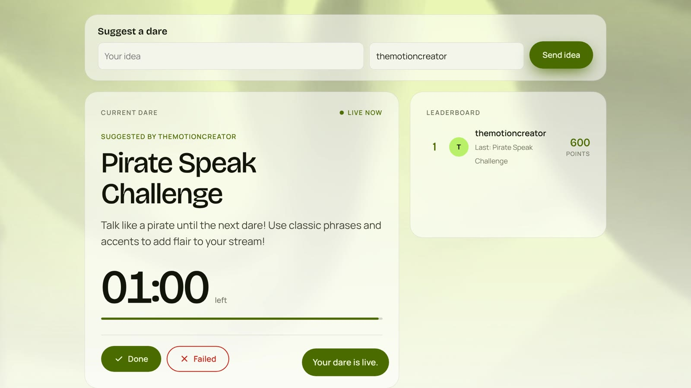
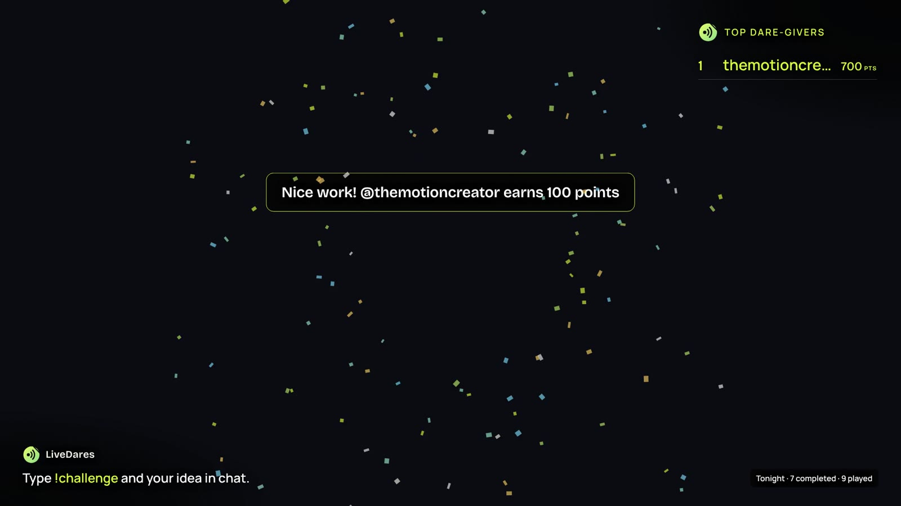
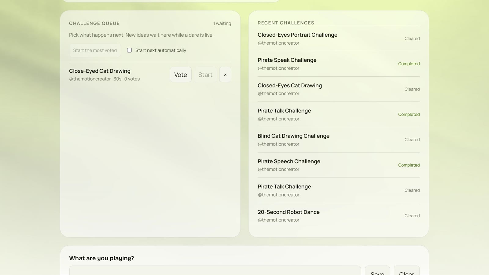
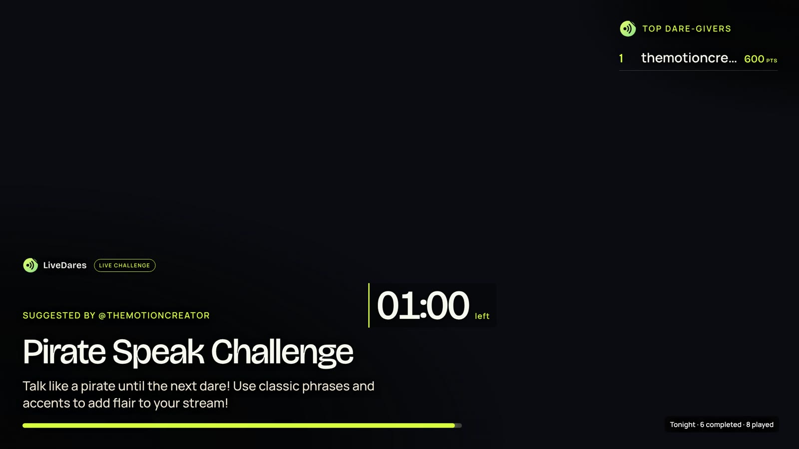
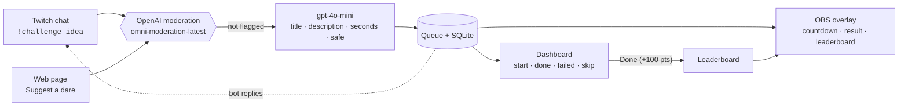

<div align="center">


# LiveDares

**Let chat dare you, then do it live.**

Twitch viewers send ideas, the OpenAI API turns them into short and safe dares with a countdown, the streamer performs them on stream, and the viewer behind each completed dare earns points.

[](https://livedare.up.railway.app)
[](https://www.twitch.tv/themotioncreator)


[Try it](#try-it-in-60-seconds) · [Features](#features) · [How it works](#how-it-works) · [Quick start](#quick-start) · [OBS setup](#add-the-overlay-in-obs) · [Commands](#chat-commands)

</div>

<p align="center">
  
  
</p>

---

## Why LiveDares

Twitch chat is full of ideas, such as "talk like a pirate" or "draw it with your eyes closed", but they scroll away in seconds. Nobody knows what's coming next, and the viewers who make a stream fun get nothing back.

LiveDares gives chat a real way to steer the show:

- **Viewers direct the stream.** Any idea from chat or the web page becomes a playable dare.
- **The streamer stays in control.** Nothing happens until the streamer starts a dare, and the streamer always decides the result.
- **Chat gets credit.** Completed dares award points, and the leaderboard is shown live on stream.

## Features

| | |
|---|---|
| 💬 **Twitch chat commands** | `!challenge <idea>`, `!vote`, `!done`, `!fail`, `!clear`, `!queue`, `!leaderboard`, `!rank` |
| 🤖 **Ideas become dares** | OpenAI moderation screens each idea, then `gpt-4o-mini` writes a title, a short description and a countdown (20, 30, 45 or 60 s) as structured JSON |
| 🗳️ **Shared queue with voting** | Up to 20 waiting dares. Chat and page votes count together. Start the most-voted dare by hand or automatically |
| 🎥 **Transparent OBS overlay** | Countdown, votes, a "Nice work!" result moment with confetti, a top dare-givers list and a nightly tally |
| 🎨 **Three overlay themes** | Midnight lime, Ember orange and Studio white, switched live from the dashboard |
| 🏆 **Persistent leaderboard** | Points, wins, history, the queue and the active deadline all survive a restart (SQLite) |
| 🌐 **No sign-in needed to try** | Anyone can send an idea from the web page, with the same safety checks, queue and points |
| 🎮 **Game-aware dares (optional)** | Uses the live Twitch game and stream title, or a game you type in, as context |
| 🛡️ **Safety and rate limits** | Moderation, a safety flag on every dare, a 40-second cooldown per person and per address, and moderator-only result commands |

<p align="center">
  
  
</p>

## How it works



1. A viewer types `!challenge talk like a pirate until the next dare` in chat, or uses the form on the page.
2. **OpenAI moderation** screens the idea. If it's flagged, the viewer is told it can't be accepted.
3. **`gpt-4o-mini`** turns it into a dare such as *"Pirate Speak Challenge: talk like a pirate until the next dare! (60 s)"*, returned as strict JSON and checked again for safety.
4. The dare goes live straight away, or joins the queue, where chat can vote with `!vote 1`.
5. The streamer performs it. On **Done**, the viewer earns **100 points**, and the overlay celebrates and updates the leaderboard in real time.

Everything updates live over Socket.IO, so the dashboard, the overlay and chat stay in sync.

## Try it in 60 seconds

No install or account needed:

1. Open **https://livedare.up.railway.app**.
2. Under **Suggest a dare**, enter an idea and a name, then select **Send idea**.
3. Open **https://livedare.up.railway.app/overlay** in a second tab to see the broadcast view.
4. Watch the countdown, select **Done**, and see the points, confetti and recent history.

To see it on Twitch, type `!challenge <your idea>` in [themotioncreator's chat](https://www.twitch.tv/themotioncreator).

## Quick start

**You need:**
- Node.js 20 or newer and npm. `better-sqlite3` may need a C++ build toolchain if no prebuilt binary is available.
- An [OpenAI API key](https://platform.openai.com/api-keys) with access to `gpt-4o-mini`.
- A Twitch channel, plus a Twitch account to post the bot's replies. This can be the streamer's own account.

```sh
git clone https://github.com/Datwebguy/livedares.git
cd livedares
npm install
cp .env.example .env   # then fill in the values below
npm start
```

Open **http://localhost:3000**. The status pill should say **Connected to Twitch**. The overlay is at **http://localhost:3000/overlay**.

### Configuration

| Variable | Required | Description |
|---|:---:|---|
| `OPENAI_API_KEY` | ✅ | Used for moderation and for writing the dares |
| `TWITCH_CHANNEL` | ✅ | The channel's login name, without `#` or a URL |
| `TWITCH_BOT_USERNAME` | ✅ | The login of the account that posts replies. It can be the same as the channel |
| `TWITCH_OAUTH` | ✅ | `oauth:` followed by a user access token with `chat:read` and `chat:edit` |
| `PORT` | | Defaults to `3000` |
| `DATABASE_PATH` | | Defaults to `./data/challenges.sqlite` |
| `TWITCH_CLIENT_ID` / `TWITCH_CLIENT_SECRET` | | Optional. Turns on game-aware dares using the live game and stream title |
| `TRUST_PROXY` | | Optional number of trusted reverse-proxy hops. Railway is detected automatically |
| `PUBLIC_URL` | | Optional public address used in link previews |

### Get a Twitch chat token

1. Sign in to Twitch as the account that will post the bot's replies. Its login name is your `TWITCH_BOT_USERNAME`.
2. Get a **user access token** with `chat:read` and `chat:edit`, using Twitch's [official OAuth guide](https://dev.twitch.tv/docs/authentication/getting-tokens-oauth/) or a trusted generator such as [twitchapps.com/tmi](https://twitchapps.com/tmi/). Third-party generators receive access to your account, so review the permissions before approving.
3. Set `TWITCH_OAUTH=oauth:<token>` with no spaces. Don't use a refresh token or a client ID.
4. Keep the token private. If it leaks, revoke it in [Twitch Connections](https://www.twitch.tv/settings/connections) and generate a new one.

## Add the overlay in OBS

1. In OBS, select **Sources → + → Browser** and name the source *LiveDares*.
2. Set the URL to `http://localhost:3000/overlay`, or use your hosted HTTPS address followed by `/overlay`.
3. Set **Width 1920** and **Height 1080**. The background is transparent.
4. Pick **Midnight lime**, **Ember orange** or **Studio white** under *OBS overlay theme* on the dashboard. The overlay changes instantly, and the choice survives a restart.

## Chat commands

| Command | Who | What it does |
|---|---|---|
| `!challenge <idea>` | Everyone | Suggest a dare. Limited to one every 40 seconds per person |
| `!vote 1` / `!vote 2` / `!vote 3` | Everyone | Vote for a waiting dare. Voting again moves your vote |
| `!queue` | Everyone | Show the next three dares and their votes |
| `!leaderboard` | Everyone | Show the top three viewers |
| `!rank` | Everyone | Show your own position and points |
| `!done` | Broadcaster and mods | Complete the dare and award **100 points** |
| `!fail` | Broadcaster and mods | Mark the dare failed. No points are awarded |
| `!clear` | Broadcaster and mods | Skip the current dare |

The dashboard buttons (**Done**, **Failed**, **Skip it**, **Start**, **Start the most voted**) do the same things.

## How the queue works

- When nothing is live, the first accepted idea starts immediately. Later ideas wait in the queue, which holds up to 20.
- The countdown starts when a dare goes live. At zero, the streamer still decides the result; it never fails automatically.
- **Start next automatically** begins the most-voted dare after a short pause.
- Ideas are processed one at a time, so a viewer may be asked to try again during a burst.

## Deploy

LiveDares runs as one Node process. On Railway, or any other container host, mount persistent storage (for example at `/data`) and set `DATABASE_PATH=/data/challenges.sqlite` so the leaderboard survives redeploys. `GET /healthz` returns `{ "ok": true }` for health checks.

## Tests

```sh
npm test
```

There are **28 automated tests**, run with Node's built-in `node:test`. They cover:
- scoring, queue order, voting and automatic start;
- cooldowns, moderation results, and unsafe or malformed AI answers;
- who may use chat commands, and chat summaries;
- persistence across restarts and clean shutdown;
- page suggestions, address handling and game context.

All network calls are injected, so the tests run offline.

The full flow (Twitch chat → OpenAI → dashboard and overlay → points) has also been run live in the [themotioncreator](https://www.twitch.tv/themotioncreator) channel on the hosted app.

## Project structure

```
server.js              Web server, live updates (Socket.IO) and the Twitch chat connection
lib/director.js        Moderation + gpt-4o-mini: turns an idea into a dare
lib/chat.js            Chat commands and who may use them
lib/store.js           SQLite: challenges, queue, votes, scores and theme
lib/suggest.js         Page suggestions with validation and cooldowns
lib/page-votes.js      Page votes, stored as salted one-way IDs rather than addresses
lib/auto-start.js      Starts the most-voted dare automatically
lib/twitch-context.js  Optional live game and stream title from the Twitch API
public/                Dashboard (index.html, app.js, style.css) and the OBS overlay
test/                  Automated tests
```

## Security notes

- LiveDares is a **single-channel** app with **no login**. Anyone who can reach the dashboard can control the dares, so keep it on a trusted network or put access protection in front of it. The overlay needs no login.
- Viewer text, the game name and the stream title are treated as untrusted content in the prompt, never as instructions.
- Page voters are stored as salted one-way identifiers, not as addresses.
- Only set `TRUST_PROXY` for proxies you control. A wrong hop count can let visitors forge their address.

## Built with OpenAI Codex

LiveDares was built with **OpenAI Codex**: the Node server, the Twitch chat bot, the OpenAI integration, the dashboard, the OBS overlay and the automated tests were written and revised in Codex, then tested live in the owner's Twitch channel.

## Credits

The flowing background clip is a free stock video from [Mixkit](https://mixkit.co/free-stock-video/abstract-red-fabric-flowing-282/), used under the [Mixkit License](https://mixkit.co/license/#videoFree).
